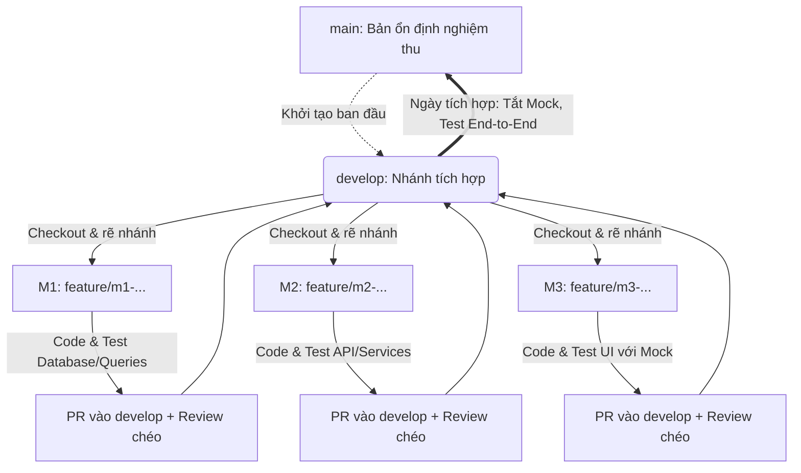

# 📘 FalkorDB Social Graph - Sổ tay phát triển (Project Log)

> Dựa trên tài liệu đặc tả kỹ thuật chi tiết [SPEC_AI_Implementation.md](file:///d:/Dev/Projects/School/doan_nosql/docs/SPEC_AI_Implementation.md) và mẫu quy trình phát triển chuẩn, tài liệu này chuẩn hóa chi tiết từng file, thư mục, quy tắc phối hợp và phân chia task cho 3 thành viên.  
> Được thiết kế đặc thù cho dự án **Cơ sở dữ liệu NoSQL Đồ thị (FalkorDB, Cypher, Node.js Express, React, Cytoscape.js)**, đảm bảo cả 3 người có thể lập trình song song mà **không bao giờ bị xung đột mã nguồn (Merge Conflict)**.

---

## 1. Tổng quan dự án

- **Tên dự án:** Mạng xã hội thu nhỏ dựa trên CSDL Đồ thị FalkorDB (FalkorDB Social Graph Network).
- **Mô tả:** Hệ thống mạng xã hội tương tác (người dùng đăng bài, gắn chủ đề, theo dõi, thích/bình luận/chia sẻ); trực quan hóa mạng lưới đồ thị và giải quyết triệt để 5 bài toán đồ thị kinh điển (BT1–BT5) kết hợp kiểm chứng hiệu năng đối chứng với CSDL quan hệ PostgreSQL.
- **Phương pháp tiếp cận:** *"Contract-First & Mock-Driven"*
  - **Đóng băng API Contract & DTO:** Ngay từ Sprint 0, toàn bộ hợp đồng API và chữ ký Repository được chốt cứng.
  - **Phát triển độc lập:** Frontend chạy Mock mode (`VITE_USE_MOCK=true`) với `axios-mock-adapter` để code toàn bộ giao diện và luồng nghiệp vụ mà không cần chờ Backend.
  - **Tách tầng tuyệt đối:** Backend phân tách rõ ràng `routes` $\rightarrow$ `services` $\rightarrow$ `repositories` $\rightarrow$ `queries`. Toàn bộ truy vấn Cypher tập trung duy nhất tại `backend/src/queries/`.

---

## 2. Công nghệ & Thư viện (Tech Stack)

| Thành phần | Công nghệ / Công cụ sử dụng | Ghi chú & Cổng dịch vụ |
| :--- | :--- | :--- |
| **CSDL Đồ thị** | FalkorDB (Redis Graph Engine) | Chạy Docker, cổng DB: `6379` |
| **GUI Quản trị DB** | FalkorDB Browser | Tích hợp sẵn trong Docker FalkorDB, cổng GUI: `3000` |
| **Backend API** | Node.js (v20+ ESM), Express 4 | Cổng `4000`, kiến trúc RESTful Envelope `{ ok, data/error }` |
| **Client CSDL** | `falkordb` (official client) | Quản lý kết nối đồ thị `social`, thực thi Cypher có tham số |
| **Bảo mật & Auth** | `jsonwebtoken`, `bcryptjs`, `helmet`, `cors` | Token JWT HS256, hash mật khẩu lưu tại node `User` |
| **Xử lý Dữ liệu** | `zod`, `nanoid`, `multer`, `csv-parse`, `csv-stringify` | Validate request, sinh ID 12 ký tự, Import/Export CSV/JSON |
| **Frontend Web** | React 18, Vite, TailwindCSS | Cổng dev: `5173`, phong cách Dark-first ("graph lab") |
| **Trực quan hóa đồ thị**| `cytoscape` + `cytoscape-fcose` | Canvas mạng lưới động, hiệu ứng glow, mở rộng láng giềng |
| **State & Fetching** | `zustand`, `@tanstack/react-query`, `axios` | Quản lý trạng thái Auth, cache API, Optimistic Updates |
| **UI Components & FX** | `lucide-react`, `recharts`, `framer-motion`, `sonner` | Icon bộ công cụ, biểu đồ thống kê, hoạt ảnh chuyển trang, Toast |
| **Mocking & Test** | `axios-mock-adapter`, `vitest`, `supertest` | Mock API độc lập cho FE, Unit/Integration Test cho BE |
| **Dữ liệu mẫu (Seed)** | `@faker-js/faker` | Sinh dữ liệu theo phân phối Zipf / Preferential Attachment (S, M, L) |
| **Benchmark Đối chứng**| PostgreSQL 16 (docker profile `bench`), `autocannon` | So sánh truy vấn đệ quy CTE vs Cypher, đo tải đồng thời |
| **Quản lý mã nguồn** | Git & GitHub | Mô hình Git Flow: `main` (ổn định) + `develop` (tích hợp) |

---

## 3. Kiến trúc thư mục (Module-First & Clear Ownership)

> **Quy tắc vàng phân quyền mã nguồn:**  
> 1. Mỗi thành viên chỉ chỉnh sửa trong thư mục được phân quyền sở hữu.  
> 2. Mọi truy vấn Cypher **bắt buộc** nằm trong `backend/src/queries/`, không viết Cypher trong routes/services.  
> 3. Không commit file rác (`node_modules/`, `.env`, dữ liệu dump lớn).

```text
nosql-social-graph/
│
├── docker-compose.yml                  # [M1] Cấu hình FalkorDB (:6379, :3000), profile bench (:5432)
├── .env.example                        # [M1] Mẫu biến môi trường mẫu chuẩn
├── README.md                           # Sổ tay phát triển dự án
├── docs/                               # [Chung] Tài liệu báo cáo, bằng chứng, đặc tả
│   ├── SPEC_AI_Implementation.md       # Đặc tả kỹ thuật nền tảng
│   ├── browser-queries.md              # [M1] Nhật ký truy vấn trên FalkorDB Browser
│   ├── backup-restore.md               # [M1] Báo cáo thực nghiệm sao lưu/phục hồi
│   ├── explain/                        # [M1] Kết quả GRAPH.EXPLAIN/PROFILE
│   └── evidence/                       # [Chung] Ảnh chụp màn hình làm bằng chứng nộp báo cáo
│
├── database/                           # [M1 SỞ HỮU] QUẢN TRỊ CSDL & DỮ LIỆU
│   ├── schema.cypher                   # Khai báo Index & Constraint duy nhất
│   ├── lib/                            # Thư viện dùng chung (M1 viết, M2 gọi)
│   │   ├── importer.js                 # Import CSV (6 loại) và JSON
│   │   ├── exporter.js                 # Export CSV theo label và JSON toàn graph
│   │   ├── backup.js                   # Logic dump graph & restore đối chiếu
│   │   └── integrity.js                # Kiểm tra 9 ràng buộc toàn vẹn dữ liệu
│   ├── seed/                           # Sinh dữ liệu mẫu có cấu trúc
│   │   ├── config.js                   # Cấu hình quy mô S/M/L/XL và tài khoản demo
│   │   ├── generate.js                 # Trình sinh ngẫu nhiên theo đồ thị thực tế
│   │   └── load.js                     # Nạp dữ liệu theo lô (Batch) có đo thời gian
│   ├── scripts/                        # Scripts tự động hóa
│   │   ├── init-schema.js              # Script khởi tạo Index & Constraint
│   │   ├── backup.sh / restore.sh      # Sao lưu vật lý dump.rdb
│   │   └── verify.js                   # Kiểm tra số lượng node/edge
│   └── data/                           # Chứa file CSV mẫu, export, backup (.gitignored)
│
├── backend/                            # BACKEND API SERVICE (Node.js 20 ESM)
│   ├── package.json                    # [M2] Dependencies & Scripts
│   └── src/
│       ├── server.js / app.js          # [M2] Khởi chạy HTTP server & nạp dynamic routes
│       ├── config/env.js               # [M2] Đọc và chuẩn hóa biến môi trường
│       ├── db/                         # [M1 SỞ HỮU]
│       │   ├── graph.js                # Kết nối FalkorDB client, hàm read/write/timed
│       │   └── graphMapper.js          # Ánh xạ bản ghi Cypher -> GraphDto chuẩn
│       ├── queries/                    # [M1 SỞ HỮU] NGUỒN SỰ THẬT DUY NHẤT CỦA CYPHER
│       │   ├── users.js                # Truy vấn CRUD User, profile, follow, search
│       │   ├── posts.js                # Truy vấn Post, Topic, Like, Comment, Share
│       │   ├── analytics.js            # Truy vấn BT1-BT5, Subgraph, Neighbor
│       │   ├── admin.js                # Truy vấn thống kê, Bulk load, Export, Toàn vẹn
│       │   └── index.js                # Export tổng hợp các module query
│       ├── repositories/               # [M1 SỞ HỮU] TẦNG GIAO TIẾP CSDL (Chữ ký đóng băng)
│       │   ├── users.repo.js           # Thực thi queries/users.js
│       │   ├── posts.repo.js           # Thực thi queries/posts.js
│       │   ├── topics.repo.js          # Thực thi queries/topics.js
│       │   ├── social.repo.js          # Thực thi queries follow & tương tác
│       │   ├── analytics.repo.js       # Thực thi queries BT1-BT5
│       │   └── admin.repo.js           # Thực thi queries quản trị hệ thống
│       ├── services/                   # [M2 SỞ HỮU] TẦNG NGHIỆP VỤ & PHÂN QUYỀN
│       │   ├── auth.service.js         # Đăng ký, đăng nhập, JWT, xác thực
│       │   ├── users.service.js        # Quản lý người dùng, khóa tài khoản
│       │   ├── posts.service.js        # Đăng bài, feed, like/comment/share, recount
│       │   ├── path.service.js         # BT1: Đường đi ngắn nhất
│       │   ├── trending.service.js     # BT2: Chủ đề nóng theo khung thời gian
│       │   ├── recommend.service.js    # BT3 & BT4: Gợi ý bạn bè & bài viết
│       │   ├── analytics.service.js    # BT5: PageRank, cộng đồng, lan truyền
│       │   └── admin.service.js        # Import/Export, Backup/Restore, Thống kê
│       ├── routes/                     # [M2 SỞ HỮU] CONTROLLER MỎNG (Tự động nạp qua app.js)
│       │   ├── auth.routes.js          # /api/auth/*
│       │   ├── users.routes.js         # /api/users/*
│       │   ├── posts.routes.js         # /api/posts/*
│       │   ├── analytics.routes.js     # /api/path, /api/analytics/*, /api/recommend/*
│       │   ├── graph.routes.js         # /api/graph/subgraph
│       │   └── admin.routes.js         # /api/admin/*
│       ├── middlewares/                # [M2 SỞ HỮU]
│       │   ├── auth.js / rbac.js       # Xác thực Token Bearer & Phân quyền 3 vai trò
│       │   ├── validate.js             # Kiểm tra dữ liệu đầu vào bằng Zod
│       │   ├── error.js                # Bắt lỗi toàn cục, trả mã lỗi HTTP chuẩn
│       │   └── audit.js                # Ghi log mọi thao tác ghi vào audit.ndjson
│       ├── utils/                      # [M2 SỞ HỮU]
│       │   ├── http.js / errors.js     # Helper response envelope {ok, data}, AppError
│       │   └── graphAlgos.js           # Thuật toán dự phòng (PageRank/WCC in-memory)
│       └── tests/                      # [M2 SỞ HỮU] Unit & Integration Tests (Vitest)
│
├── benchmark/                          # HIỆU NĂNG & ĐỐI CHỨNG
│   ├── run-graph.js                    # [M1] Benchmark truy vấn trên FalkorDB
│   ├── run-pg.js                       # [M2] Benchmark truy vấn đệ quy CTE trên PostgreSQL
│   ├── run-concurrency.js              # [M2] Kiểm thử tải đồng thời với Autocannon
│   └── results/summary.json            # [Chung] Báo cáo hiệu năng tổng hợp
│
└── frontend/                           # [M3 SỞ HỮU] GIAO DIỆN NGƯỜI DÙNG (React + Vite)
    ├── package.json                    # Cấu hình dependencies frontend
    ├── vite.config.js / tailwind.config.js # Thiết lập Dark theme & Tokens
    └── src/
        ├── main.jsx / App.jsx          # Entrypoint & Shell ứng dụng
        ├── router.jsx                  # Cấu hình Router & Protected Route theo Role
        ├── api/
            ├── client.js               # Axios instance tự bóc envelope & kèm Bearer Token
            ├── endpoints.js            # Định nghĩa URL gọi API
            └── mock/                   # MOCK ADAPTER PHỤC VỤ PHÁT TRIỂN ĐỘC LẬP
                ├── index.js            # Cấu hình axios-mock-adapter (delay 300-500ms)
                └── fixtures/           # Dữ liệu JSON giả lập đúng chuẩn DTO mục 6
        ├── store/auth.js               # Quản lý trạng thái đăng nhập (Zustand)
        ├── lib/
            ├── graphTheme.js           # Màu sắc node/edge, style Cytoscape
            └── format.js               # Định dạng ngày giờ, số liệu rút gọn
        ├── components/
            ├── layout/                 # Sidebar theo role, Header, CommandPalette (Ctrl+K)
            ├── ui/                     # Button, Input, Modal, Toast, Skeleton, Badge
            ├── graph/GraphCanvas.jsx   # Thành phần vẽ đồ thị Cytoscape.js
            └── post/PostCard.jsx       # Card bài viết (Like animation, Comment popover)
        └── pages/
            ├── Login.jsx / Feed.jsx    # Đăng nhập, Bảng tin mạng xã hội
            ├── Explore.jsx             # UC-04: Khám phá mạng lưới đồ thị tương tác
            ├── PathFinder.jsx          # BT1 (UC-09): Tìm đường đi ngắn nhất giữa 2 user
            ├── Trending.jsx            # BT2 (UC-10): Biểu đồ thanh chủ đề nóng
            ├── Discover.jsx            # BT3/BT4 (UC-11/12): Gợi ý bạn bè & bài viết
            ├── Analytics.jsx           # BT5 (UC-13/14): PageRank, Cây lan truyền bài viết
            ├── Dashboard.jsx           # UC-16: Thống kê tổng quan & Phân bố bậc
            ├── Benchmark.jsx           # Bảng & biểu đồ so sánh Graph vs PostgreSQL
            └── admin/                  # Admin Users, Topics, Data (Import/Export), Backup
```

---

## 4. Quy trình làm việc nhóm (Team Workflow)

### 4.1. Chiến lược phân nhánh (Branching Strategy)
- **Repository Remote:** Cấu hình remote trên GitHub của nhóm.
- **Nhánh `main` (Production / Stable Release):**
  - Chỉ chứa mã nguồn ổn định, đã vượt qua kiểm thử tích hợp cuối mỗi Sprint.
  - **Tuyệt đối KHÔNG commit trực tiếp vào `main`.** Chỉ merge từ `develop` khi nghiệm thu Sprint.
- **Nhánh `develop` (Main Integration Branch):**
  - Nhánh tích hợp trung tâm của cả 3 thành viên. Mọi Pull Request (PR) đều hướng về đây.
- **Nhánh tính năng (`feature/mX-ten-task` hoặc `fix/mX-ten-loi`):**
  - M1: `feature/m1-schema-seed`, `feature/m1-queries-bt1-bt5`, ...
  - M2: `feature/m2-auth-rbac`, `feature/m2-post-routes`, `feature/m2-pg-benchmark`, ...
  - M3: `feature/m3-graph-canvas`, `feature/m3-feed-ui`, `feature/m3-admin-backup`, ...

### 4.2. Quy tắc đặt tên Commit (Conventional Commits)
- `feat:` Thêm chức năng mới (VD: `feat: Thêm query shortestPath và repo analytics`)
- `fix:` Sửa lỗi (VD: `fix: Sửa lỗi đếm sai số lượng comment khi recount`)
- `docs:` Viết hoặc cập nhật tài liệu (VD: `docs: Bổ sung ảnh chụp query trên FalkorDB Browser`)
- `perf:` Tối ưu hóa hiệu năng hoặc chỉ mục

### 4.3. Vòng lặp công việc hàng ngày (Daily Routine)



1. **Đồng bộ nhánh develop mới nhất mỗi sáng:**
   ```bash
   git checkout develop
   git pull origin develop
   ```
2. **Tạo nhánh làm việc riêng cho task:**
   ```bash
   git checkout -b feature/m1-seed-data # Hoặc m2, m3
   ```
3. **Lập trình độc lập & Tuân thủ giao ước:**
   - M1: Kiểm tra tính đúng đắn của Cypher trên Browser/CLI trước khi đưa vào repo.
   - M2: Viết test case `supertest` kiểm tra status HTTP và envelope trả về.
   - M3: Bật `VITE_USE_MOCK=true` để hoàn thiện UI/UX và animation độc lập.
4. **Tạo Pull Request:** Tạo PR vào `develop`, bắt buộc ít nhất 1 thành viên khác review trước khi merge.
5. **Ngày tích hợp (Cuối mỗi Sprint):** M3 chuyển `VITE_USE_MOCK=false`, cả 3 cùng chạy thử end-to-end trên máy cục bộ để xử lý sai lệch (nếu có).

### 4.4. Quy tắc "Bất di bất dịch" (Definition of Done & Code Rules)
- [ ] **Cypher cô lập:** 100% Cypher phải nằm trong `backend/src/queries/`. Tuyệt đối không viết câu lệnh Cypher trong service, controller hay frontend.
- [ ] **Tham số hóa truy vấn:** Luôn truyền tham số qua `$param`. Cấm tuyệt đối nối chuỗi SQL/Cypher (ngoại trừ tham số độ sâu duyệt đồ thị `*..N` sau khi đã kiểm tra `Number.isInteger(N)` trong dải 1..6).
- [ ] **Chuẩn hóa ID & Thời gian:** Dùng `nanoid(12)` sinh ID định danh; thời gian lưu bằng số nguyên epoch milliseconds (`Date.now()`).
- [ ] **Bảo mật mật khẩu:** Không bao giờ trả thuộc tính `passwordHash` ra API trong bất kỳ DTO nào.
- [ ] **Chuẩn Response Envelope:** Mọi endpoint đều phải trả về:
  - Thành công: `{ ok: true, data: ... }`
  - Thất bại: `{ ok: false, error: { code: string, message: string } }`
- [ ] **Không commit file rác:** Kiểm tra kỹ file `.gitignore` để tránh đẩy file database, backup, `node_modules`, `.env`.

---

## 5. Phân chia Task chi tiết - SPRINT 0 & 1: Nền móng & CRUD Cốt lõi

### 👨‍💻 Thành viên 1: Data & Graph Master (M1)
**Mục tiêu:** Dựng Docker FalkorDB, kết nối Browser, thiết lập Index/Constraint, hoàn thiện Queries & Repositories CRUD cốt lõi và nạp dữ liệu mẫu quy mô S.

| Task | Vị trí file | Tên file / Module | Outcome chi tiết |
| :--- | :--- | :--- | :--- |
| **S0-1. Docker & Config** | Gốc dự án | `docker-compose.yml`<br>`.env.example` | Chạy FalkorDB (port 6379) + Browser (port 3000) bằng Docker Compose; file `.env.example` chuẩn. |
| **S0-2. Schema & Client** | `database/`<br>`backend/src/db/` | `schema.cypher`<br>`init-schema.js`<br>`graph.js`, `graphMapper.js` | Tạo 6 Index & 5 Constraint; kết nối client `falkordb`; hàm chuyển đổi node/edge sang `GraphDto`. |
| **T1-1. Queries CRUD** | `backend/src/queries/`<br>`backend/src/repositories/`| `users.js`, `posts.js`<br>`*.repo.js` | Viết truy vấn Cypher và hàm Repository cho User, Post, Topic, Follow, Like, Comment, Share. |
| **T1-2. Seed Data (Scale S)**| `database/seed/`<br>`database/lib/` | `config.js`, `generate.js`<br>`load.js`, `integrity.js` | Sinh và nạp 1.000 User, 5.000 Post, 50 Topic theo lô; kiểm tra 9 ràng buộc toàn vẹn đạt 100% xanh. |
| **T1-9. FalkorDB Browser**| `docs/` | `docs/browser-queries.md` | Chuẩn bị và chụp ảnh màn hình các câu truy vấn cơ bản trên FalkorDB Browser (đếm node, lọc theo thời gian). |

---

### 👨‍💻 Thành viên 2: Backend & Hệ thống (M2)
**Mục tiêu:** Khởi tạo khung Express ESM, Middleware bảo mật, xác thực JWT, phân quyền RBAC, kiểm tra dữ liệu bằng Zod và hoàn thiện API CRUD.

| Task | Vị trí file | Tên file / Module | Outcome chi tiết |
| :--- | :--- | :--- | :--- |
| **S0-3. Server Boilerplate**| `backend/src/` | `package.json`, `app.js`<br>`server.js`, `config/env.js` | Khởi tạo Express 4 ESM, tự động nạp `routes/*.routes.js`, endpoint `GET /api/health` trả `{db:'up'}`. |
| **S0-4. Auth & Token** | `backend/src/` | `services/auth.service.js`<br>`routes/auth.routes.js` | API `/api/auth/register`, `/login`, `/me`; mật khẩu mã hóa bcryptjs, cấp phát token JWT HS256. |
| **T1-3. Middlewares Nền** | `backend/src/middlewares/`<br>`backend/src/utils/` | `auth.js`, `rbac.js`, `validate.js`<br>`error.js`, `audit.js`, `http.js` | Bắt lỗi tập trung, chặn vai trò trái phép, validate schema bằng Zod, ghi log thao tác vào `audit.ndjson`. |
| **T1-4. User APIs** | `backend/src/` | `services/users.service.js`<br>`routes/users.routes.js` | CRUD người dùng, khóa/mở tài khoản (`/status`), phân quyền (`/role`); bảo vệ bằng RBAC. |
| **T1-5. Topics & Follow** | `backend/src/` | `services/topics.service.js`<br>`routes/topics.routes.js` | Quản lý chủ đề (admin), API theo dõi / bỏ theo dõi (`/follow`), cập nhật sở thích chủ đề (`/me/interests`). |
| **T1-6. Post & Interactions**| `backend/src/` | `services/posts.service.js`<br>`routes/posts.routes.js` | Đăng bài, bảng tin (Feed), tương tác Like/Comment/Share và cơ chế Recount số đếm tự động. |

---

### 👨‍💻 Thành viên 3: Frontend & UX Master (M3)
**Mục tiêu:** Xây dựng khung ứng dụng React (Vite + TailwindCSS Dark Mode), Design System hoàn chỉnh, cài đặt Mock Adapter và màn hình Feed/Admin.

| Task | Vị trí file | Tên file / Module | Outcome chi tiết |
| :--- | :--- | :--- | :--- |
| **S0-5. Khung Frontend** | `frontend/` | `package.json`, `vite.config.js`<br>`tailwind.config.js`, `router.jsx` | Khởi tạo dự án Vite React, cấu hình Tailwind Dark-first, định tuyến có bảo vệ theo trạng thái đăng nhập. |
| **S0-6. Mock Adapter** | `frontend/src/api/` | `client.js`<br>`mock/index.js`, `fixtures/*` | Thiết lập `axios-mock-adapter` chạy khi `VITE_USE_MOCK=true`, cung cấp fixture JSON chuẩn DTO. |
| **T1-7. Design System** | `frontend/src/components/ui/`| `Button.jsx`, `Card.jsx`, `Input.jsx`<br>`Modal.jsx`, `Toast.jsx`, `Skeleton.jsx` | Bộ component UI nguyên tử mang phong cách kính mờ (glassmorphism), viền phát sáng (glow), font Inter. |
| **T1-8. Core Screens** | `frontend/src/pages/` | `Login.jsx`, `Feed.jsx`<br>`Profile.jsx`, `admin/Users.jsx` | Trang đăng nhập; bảng tin với PostCard (hiệu ứng like tim, popover comment); trang cá nhân và quản trị user. |

---

## 6. Phân chia Task chi tiết - SPRINT 2 & 3: 5 Bài toán Đồ thị, Quản trị Dữ liệu & Trực quan hóa

### 👨‍💻 Thành viên 1: Thuật toán Đồ thị & Quản trị Dữ liệu (M1)
- **T2-1. Kiểm chứng phiên bản FalkorDB (Ưu tiên số 1):** Chạy thử nghiệm các hàm `shortestPath`, `algo.pageRank`, `algo.WCC` trên FalkorDB Browser; điền kết quả vào mục 14 của file đặc tả.
- **T2-2. Queries BT1–BT5 & Subgraph:** Hiện thực toàn bộ câu truy vấn Cypher và Repository cho:
  - *BT1:* `shortestPath` trên quan hệ `FOLLOWS` (độ sâu tối đa 6 bước).
  - *BT2:* `trendingLikes/Comments/Shares` theo mốc thời gian.
  - *BT3 & BT4:* `friendSuggestions`, `postSuggestions` (kèm fallback cold-start).
  - *BT5:* `topFollowers`, `pageRank`, `allFollowEdges`, `wcc`, `spreadRows` (truy vết lan truyền).
  - *Canvas:* `neighborhood` và `overview` để phục vụ màn hình trực quan hóa.
- **T2-3. Seed Data Scale M & EXPLAIN:** Nạp dữ liệu 10.000 User, 50.000 Post; chạy `GRAPH.EXPLAIN` và `GRAPH.PROFILE` cho các truy vấn BT1–BT5, lưu vào thư mục `docs/explain/`.
- **T3-1. Thư viện Nhập/Xuất & Sao lưu:** Hoàn thiện `database/lib/importer.js` (CSV 6 loại, JSON), `exporter.js`, `backup.js` (dump JSON logic) và `integrity.js`.
- **T3-2. Sao lưu vật lý & Scale L:** Viết `backup.sh` và `restore.sh` cho file `dump.rdb`; thực nghiệm trên dữ liệu quy mô L (100.000 user).

---

### 👨‍💻 Thành viên 2: API Phân tích, Thuật toán Dự phòng & Quản trị (M2)
- **T2-4 & T2-5. Dịch vụ Phân tích & Gợi ý (BT1–BT5):**
  - Viết Service & Route cho `/path`, `/topics/trending`, `/recommend/friends`, `/recommend/posts`.
  - Viết `utils/graphAlgos.js`: Cài đặt thuật toán PageRank và WCC (Weakly Connected Components) bằng JavaScript in-memory làm phương án dự phòng khi môi trường thiếu module `algo.*`.
  - Triển khai bộ nhớ đệm Cache TTL 60s cho kết quả Trending và Phân tích ảnh hưởng.
- **T3-3. Admin Data Routes:** Xây dựng API `/api/admin/import` (nhận multipart file CSV/JSON qua Multer), `/api/admin/export`, `/api/admin/backup`, `/api/admin/restore`, `/api/admin/integrity`.
- **T3-4. Hoàn thiện RBAC & Audit:** Kiểm soát nghiêm ngặt 3 vai trò (`admin`, `analyst`, `user`), ghi nhận vết thao tác ghi vào `audit.ndjson`.
- **T3-5. Bộ Kiểm thử Tự động:** Viết bộ test case `tests/*.test.js` bằng `vitest` + `supertest` kiểm tra mọi trường hợp hợp lệ và lỗi (400, 401, 403, 404, 409).

---

### 👨‍💻 Thành viên 3: Trực quan hóa Mạng lưới & Màn hình Chuyên đề (M3)
- **T2-6. Canvas Đồ thị Tương tác (`GraphCanvas.jsx`):**
  - Tích hợp `cytoscape` và layout `fcose`; hiển thị nút theo màu sắc và kích thước bậc kết nối.
  - Hiệu ứng tương tác: Hover làm nổi bật láng giềng và làm mờ phần còn lại; Click mở Sidebar chi tiết thuộc tính; Nút "Mở rộng láng giềng" (gọi API lấy subgraph rồi merge).
  - Màn hình `/explore` và `/path` (hiệu ứng đường đi chạy animation dash-offset, hộp tóm tắt "Cách nhau N bước").
- **T2-7. Màn hình Bài toán Nghiệp vụ:**
  - Trang `/trending`: Biểu đồ cột ngang (Recharts) chọn khoảng thời gian 1/7/30 ngày.
  - Trang `/discover`: Thẻ gợi ý bạn bè (lý do gợi ý, bạn chung) và bài viết quan tâm; thanh tìm kiếm nhanh toàn cục (phím tắt `Ctrl+K`).
- **T3-6. Quản trị Dữ liệu & Quy trình Sao lưu:**
  - Trang `/admin/data`: Kéo thả file Import CSV/JSON, nút Export, hiển thị bảng kiểm tra toàn vẹn dữ liệu.
  - Trang `/admin/backup`: Thiết kế Stepper 4 bước (**Sao lưu $\rightarrow$ Xóa trắng graph $\rightarrow$ Phục hồi $\rightarrow$ Đối chiếu 100% số lượng node/cạnh** có dấu tick xanh khi trùng khớp).
- **T3-7. Analytics Dashboard:** Biểu đồ phân phối bậc (Degree Distribution), bảng xếp hạng PageRank/Followers có huy hiệu Top 3, sơ đồ cây lan truyền bài viết (Spread Tree).

---

## 7. Phân chia Task chi tiết - SPRINT 4 & 5: Benchmark, Đóng gói & Tổng duyệt Demo

### 👨‍💻 Thành viên 1: Benchmark Đồ thị & Đóng gói Docker (M1)
- **T4-1. Đo kiểm FalkorDB (`run-graph.js`):** Thực thi kịch bản đo độ trễ các bài toán BT1–BT5 qua các quy mô S, M, L với độ sâu duyệt từ 1 đến 6 bước; lặp $\ge$ 30 lần, loại bỏ 5 lần đầu (warm-up), tính toán giá trị Trung bình, Trung vị và p95.
- **T4-2. Báo cáo Tối ưu hóa Chỉ mục:** So sánh `GRAPH.EXPLAIN/PROFILE` trước và sau khi đánh chỉ mục trên các thuộc tính khóa; lập báo cáo `docs/explain/before-after.md`.
- **T5-1. Đóng gói Toàn diện:** Viết `Dockerfile` cho Backend và Frontend, hoàn thiện `docker-compose.yml` để khởi động toàn bộ hệ sinh thái chỉ với 1 câu lệnh `docker compose up`.

---

### 👨‍💻 Thành viên 2: Đối chứng PostgreSQL & Tải đồng thời (M2)
- **T4-3. Đối chứng PostgreSQL (`run-pg.js`):** Dựng Docker PostgreSQL (profile `bench`), nạp dữ liệu quan hệ đối ứng từ file export của M1; viết câu truy vấn đệ quy CTE cho bài toán tìm đường đi BT1, bạn của bạn BT3 và so sánh thời gian thực thi.
- **T4-4. Kiểm thử Tải đồng thời (`run-concurrency.js`):** Sử dụng `autocannon` bắn tải đồng thời (1, 10, 50, 100 connections) vào các endpoint trọng yếu; tổng hợp kết quả thành file `benchmark/results/summary.json` và cung cấp API `GET /api/benchmark`.
- **T5-2. Hướng dẫn & Tài liệu API:** Hoàn thiện tài liệu `README.md`, xuất tài liệu `docs/API.md` chuẩn hóa toàn bộ endpoints.

---

### 👨‍💻 Thành viên 3: Giao diện Benchmark & Kịch bản Demo (M3)
- **T4-6. Màn hình `/benchmark`:** Trực quan hóa dữ liệu so sánh giữa FalkorDB và PostgreSQL dạng biểu đồ đường và biểu đồ cột (độ trễ theo độ sâu, khả năng chịu tải đồng thời).
- **T4-7. Đánh bóng UI/UX:** Tối ưu hóa hoạt ảnh chuyển trang (`framer-motion`), giao diện co giãn responsive trên màn hình tablet, thiết kế các trạng thái rỗng (Empty State) và thông báo lỗi thân thiện.
- **T5-3. Kịch bản Demo & Video:** Soạn thảo kịch bản thuyết trình demo từ 10–12 phút phân chia rõ vai trò nói của từng người, quay video dự phòng đầy đủ các tính năng.

---

## 8. Sổ tay xử lý sự cố thường gặp (Troubleshooting)

| Triệu chứng lỗi | Nguyên nhân tiềm ẩn | Giải pháp khắc phục & Người phụ trách |
| :--- | :--- | :--- |
| **Backend báo lỗi "DB chưa kết nối" khi khởi động** | FalkorDB container chưa sẵn sàng hoặc sai mật khẩu trong `.env`. | Kiểm tra `docker ps` xem container `falkordb` đã up chưa; kiểm tra giá trị `FALKORDB_PASSWORD` trong `.env` phải khớp với cấu hình trong `docker-compose.yml`. *(M1)* |
| **Lỗi `SYNTAX ERROR: Unknown function shortestPath`** | Phiên bản FalkorDB đang dùng cú pháp hàm tìm đường đi khác hoặc thiếu ngoặc. | Chạy thử câu truy vấn trực tiếp trên FalkorDB Browser (`:3000`). Nếu không hỗ trợ, chuyển sang thuật toán BFS dự phòng trong `backend/src/utils/graphAlgos.js`. *(M1/M2)* |
| **Frontend báo lỗi CORS khi gọi API Backend** | Backend chưa cho phép Origin từ Vite frontend (`http://localhost:5173`). | Kiểm tra biến `CORS_ORIGIN` trong `.env` của Backend; đảm bảo middleware `cors({ origin: env.corsOrigin })` được gọi trước các routes trong `app.js`. *(M2)* |
| **Đồ thị Cytoscape không vẽ hoặc canvas trắng xóa** | Thẻ div chứa canvas chưa có kích thước cố định (`height: 100%`) hoặc dữ liệu truyền vào sai định dạng `GraphDto`. | Đảm bảo thẻ cha có class `h-full w-full relative`. Kiểm tra console xem `nodes` và `edges` có đúng cấu trúc `{ data: { id, source, target } }` hay không. *(M3)* |
| **Xung đột mã nguồn (Merge Conflict) ở `SPEC_AI_Implementation.md`** | 2 thành viên tự ý sửa đổi hợp đồng API hoặc DTO mà chưa họp thống nhất. | **Tuyệt đối không tự ý ghi đè.** Mở thảo luận nhóm 5 phút, thống nhất hợp đồng rồi commit trong một PR riêng trước khi tiếp tục code. *(Cả nhóm)* |
| **Không tìm thấy đường đi giữa 2 người dùng (BT1)** | Đồ thị bị phân mảnh thành nhiều thành phần liên thông rời rạc hoặc vượt quá `maxDepth=6`. | Dùng FalkorDB Browser kiểm tra lại dữ liệu seed xem có đường nối `FOLLOWS` giữa 2 username đó không; thử tăng tạm thời `maxDepth` để kiểm tra. *(M1/M3)* |
| **Lỗi tràn bộ nhớ (Heap Out of Memory) khi Import CSV lớn** | Đọc toàn bộ file dung lượng lớn vào RAM trước khi xử lý. | Chuyển sang đọc stream từng dòng bằng `csv-parse` và nạp vào DB theo từng lô (Batching 2.000 dòng/lần với câu lệnh `UNWIND $rows`). *(M1)* |

---

## 9. Checklist nghiệm thu trước khi nộp đồ án & Demo

- [ ] Lệnh `docker compose up` chạy thành công toàn bộ hệ thống (FalkorDB, Backend, Frontend) trên một máy tính sạch không cần cấu hình thêm.
- [ ] Truy cập được vào **FalkorDB Browser** tại địa chỉ `http://localhost:3000` và thực thi truy vấn thành công.
- [ ] Dữ liệu mẫu quy mô **M (Medium - 10.000 users, 50.000 posts)** đã được nạp sẵn; 3 tài khoản demo (`admin`, `analyst`, `alice` với mật khẩu chung `Passw0rd!`) đăng nhập bình thường.
- [ ] Kiểm tra toàn vẹn CSDL tại `/admin/data` (hoặc qua API `GET /api/admin/integrity`) hiển thị **100% trạng thái đạt (xanh)**.
- [ ] Trình diễn thành công kịch bản **Sao lưu $\rightarrow$ Xóa trắng đồ thị $\rightarrow$ Phục hồi $\rightarrow$ Bảng đối chiếu số node/cạnh khớp 100%**.
- [ ] Cả 5 bài toán đồ thị (BT1–BT5) hoạt động mượt mà trên giao diện người dùng, canvas đồ thị trực quan có highlight đường đi và mở rộng láng giềng.
- [ ] Màn hình Benchmark hiển thị đầy đủ biểu đồ so sánh độ trễ giữa FalkorDB và PostgreSQL.
- [ ] Đã quay sẵn 01 video demo hoàn chỉnh (thời lượng 10–12 phút) dự phòng cho buổi bảo vệ chính thức.

> 💡 **Lời khuyên cho cả nhóm:** Sức mạnh của dự án nằm ở **Kiến trúc phân tầng triệt để** và **Chế độ Mock độc lập**. **M3** có thể tự tin làm giao diện lộng lẫy trên Mock data mà không bị tắc nghẽn bởi Backend; **M1** tập trung tối ưu hóa các câu truy vấn Cypher và đo đạc hiệu năng đồ thị; còn **M2** đảm bảo tính toàn vẹn, bảo mật và logic nghiệp vụ của toàn hệ thống. Chúc nhóm phối hợp ăn ý và đạt điểm số tối đa!
