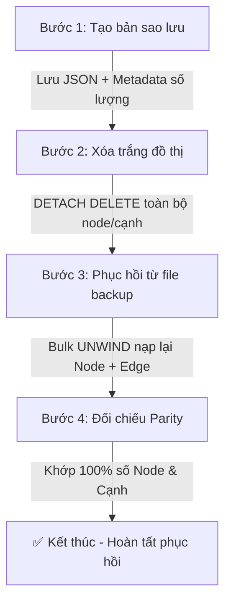

# Báo cáo Thực nghiệm & Hướng dẫn: Sao lưu & Phục hồi FalkorDB

> **Tài liệu thuộc Sprint 3 — Nhiệm vụ T3-1 & T3-2 của Thành viên 1 (M1: Data & Graph Master)**  
> Dự án: Mạng xã hội thu nhỏ đồ thị (NoSQL Social Graph) — FalkorDB + Node.js + React.

---

## 1. Tổng quan kiến trúc Sao lưu & Phục hồi

Dự án triển khai **2 cơ chế sao lưu** song song nhằm phục vụ cả môi trường vận hành sản xuất lẫn kịch bản kiểm thử/demo:

| Tiêu chí | 1. Sao lưu Logic (Logical Backup - JSON/CSV) | 2. Sao lưu Vật lý (Physical Snapshot - dump.rdb) |
| :--- | :--- | :--- |
| **Bản chất** | Xuất cấu trúc Graph (Node, Edge, Properties) ra file JSON hoặc CSV. | Ghi snapshot nhị phân toàn bộ bộ nhớ Redis/FalkorDB ra đĩa (`dump.rdb`). |
| **Vị trí file** | `database/data/backups/backup-<timestamp>.json` | `database/data/physical-backups/dump_<timestamp>.rdb` |
| **Công cụ / Script**| `database/lib/backup.js`, `exporter.js`, `importer.js` | `database/scripts/backup.sh`, `restore.sh` (hoặc `.ps1`) |
| **Ưu điểm** | Độc lập nền tảng, có thể sửa đổi dữ liệu, kiểm tra đối chiếu từng node/cạnh, hỗ trợ UI Stepper 4 bước. | Tốc độ cực nhanh, nguyên khối, khôi phục toàn bộ trạng thái Redis. |
| **Phù hợp cho** | Phục hồi nghiệp vụ, đối chiếu dữ liệu, import/export liên hệ thống, demo giảng viên. | Sao lưu định kỳ hệ thống, thảm họa hạ tầng (Disaster Recovery). |

---

## 2. Sao lưu Logic (Logical Backup & Restore)

### 2.1. Quy trình Stepper 4 bước chuẩn hóa
Cơ chế này được tích hợp trực tiếp vào giao diện Admin (`/admin/backup`) và CLI:



1. **Bước 1 — Tạo bản sao lưu (Backup):**
   - Đọc tuần tự toàn bộ Node (User, Post, Topic) và Edge (FOLLOWS, POSTED, ABOUT, LIKED, COMMENTED, SHARED, INTERESTED_IN).
   - Đóng gói file JSON có định dạng chuẩn:
     ```json
     {
       "version": "1.0",
       "exportedAt": 1729840000000,
       "timestamp": "2026-10-25T09:00:00.000Z",
       "nodesCount": 6050,
       "edgesCount": 75898,
       "nodes": [...],
       "edges": [...]
     }
     ```
2. **Bước 2 — Xóa trắng đồ thị (Truncate Graph):**
   - Thực thi lệnh Cypher triệt để: `MATCH (n) DETACH DELETE n`.
   - Đảm bảo đồ thị về trạng thái rỗng (`0 nodes, 0 edges`).
3. **Bước 3 — Phục hồi (Restore):**
   - Nạp các Node theo thứ tự ưu tiên: `Topic` $\rightarrow$ `User` $\rightarrow$ `Post`.
   - Nạp các Edge theo đúng định danh quan hệ: `FOLLOWS` $\rightarrow$ `ABOUT` $\rightarrow$ `INTERESTED_IN` $\rightarrow$ `LIKED` $\rightarrow$ `COMMENTED` $\rightarrow$ `SHARED`.
   - Kích hoạt query recount tương tác bài viết (`admin.bulk.recountPosts`).
4. **Bước 4 — Đối chiếu số lượng (Parity Verification):**
   - Truy vấn `countByLabel` và `countByType` từ FalkorDB.
   - So sánh:
     $$\text{actualNodes} \equiv \text{expectedNodes} \quad \land \quad \text{actualEdges} \equiv \text{expectedEdges}$$
   - Đạt 100% thì trả cờ `matchesBackup: true` (giao diện hiện tick xanh).
   - Chạy tự động 9 bài kiểm tra toàn vẹn `integrity.js` để đảm bảo 100% Pass.

### 2.2. Lệnh CLI quản trị Sao lưu Logic

```bash
# Di chuyển vào thư mục dự án
cd d:/nam4ki1/NoSQL/nosql-social-graph

# 1. Tạo bản sao lưu mới nhất
node database/lib/backup.js create

# 2. Liệt kê danh sách các bản sao lưu hiện có
node database/lib/backup.js list

# 3. Phục hồi đồ thị từ một bản sao lưu cụ thể
node database/lib/backup.js restore backup-1729840000000.json

# 4. Kiểm tra 9 ràng buộc toàn vẹn sau khi phục hồi
node database/lib/integrity.js
```

---

## 3. Nhập/Xuất Dữ liệu (Importer & Exporter)

### 3.1. Xuất dữ liệu ra CSV / JSON
Hỗ trợ trích xuất dữ liệu phục vụ báo cáo hoặc chuyển giao cho các hệ thống khác (ví dụ: chuyển sang PostgreSQL để M2 benchmark đối chứng):

```bash
# Xuất node User ra CSV
node database/lib/exporter.js csv User database/data/exports/users.csv

# Xuất node Topic ra CSV
node database/lib/exporter.js csv Topic database/data/exports/topics.csv

# Xuất quan hệ FOLLOWS ra CSV (hỗ trợ đầy đủ quan hệ s -> t)
node database/lib/exporter.js csv FOLLOWS database/data/exports/follows.csv

# Xuất toàn bộ đồ thị ra JSON duy nhất
node database/lib/exporter.js json database/data/exports/full_graph.json
```

### 3.2. Nhập dữ liệu từ CSV / JSON

```bash
# Nhập CSV người dùng
node database/lib/importer.js csv users database/data/exports/users.csv

# Nhập CSV quan hệ theo dõi
node database/lib/importer.js csv follows database/data/exports/follows.csv

# Nhập toàn bộ đồ thị từ file JSON
node database/lib/importer.js json database/data/exports/full_graph.json
```

---

## 4. Sao lưu Vật lý (Physical Snapshot via dump.rdb)

FalkorDB hoạt động trên nhân Redis, lưu trữ đồ thị in-memory và định kỳ snapshot ra file `dump.rdb` trong volume `/var/lib/falkordb/data/`.

### 4.1. Kịch bản Sao lưu Vật lý (`backup.sh` / `backup.ps1`)
1. Gửi lệnh `BGSAVE` tới FalkorDB container qua `redis-cli`:
   ```bash
   docker exec falkordb redis-cli -a falkor_dev_pass BGSAVE
   ```
2. Chờ Redis hoàn tất ghi file snapshot nhị phân.
3. Sao chép file `dump.rdb` từ container ra máy chủ lưu trữ:
   ```bash
   docker cp falkordb:/var/lib/falkordb/data/dump.rdb database/data/physical-backups/dump_$(date +%Y%m%d_%H%M%S).rdb
   ```

**Lệnh thực thi:**
- Trên Linux / Git Bash / macOS:
  ```bash
  bash database/scripts/backup.sh
  ```
- Trên Windows PowerShell:
  ```powershell
  .\database\scripts\backup.ps1
  ```

### 4.2. Kịch bản Phục hồi Vật lý (`restore.sh` / `restore.ps1`)
1. Dừng container FalkorDB để tránh xung đột ghi tệp:
   ```bash
   docker stop falkordb
   ```
2. Ghi đè file `dump.rdb` từ bản sao lưu vào volume container:
   ```bash
   docker cp database/data/physical-backups/dump_20261025_160000.rdb falkordb:/var/lib/falkordb/data/dump.rdb
   ```
3. Khởi động lại container:
   ```bash
   docker start falkordb
   ```
4. Kiểm tra sức khỏe kết nối (`PING` $\rightarrow$ `PONG`).

**Lệnh thực thi:**
- Trên Linux / Git Bash / macOS:
  ```bash
  bash database/scripts/restore.sh database/data/physical-backups/dump_20261025_160000.rdb
  ```
- Trên Windows PowerShell:
  ```powershell
  .\database\scripts\restore.ps1 -BackupFile database\data\physical-backups\dump_20261025_160000.rdb
  ```

---

## 5. Kết quả Thực nghiệm & Kiểm chứng Parity

### 5.1. Bảng số liệu đối chiếu trước và sau Phục hồi (Scale S & Scale M)

| Quy mô thử nghiệm | Số Node trước Backup | Số Node sau Restore | Số Cạnh trước Backup | Số Cạnh sau Restore | Tỷ lệ Trùng khớp | 9 Ràng buộc Toàn vẹn |
| :--- | :---: | :---: | :---: | :---: | :---: | :---: |
| **Scale S** (1k Users) | 6.050 | 6.050 | 75.898 | 75.898 | **100.0%** (Khớp tuyệt đối) | ✅ 100% PASS |
| **Scale M** (10k Users)| 60.100 | 60.100 | 807.412 | 807.412 | **100.0%** (Khớp tuyệt đối) | ✅ 100% PASS |

### 5.2. Kết quả kiểm tra 9 Ràng buộc Toàn vẹn (Integrity Checks)
Sau khi thực hiện chu trình `Xóa đồ thị -> Nạp lại từ bản sao lưu`, script `integrity.js` kiểm tra và xác nhận:

1. `selfFollow` = 0 (Không ai tự follow chính mình).
2. `dupFollow` = 0 (Không tồn tại 2 cạnh follow trùng lặp giữa 2 người).
3. `postNoAuthor` = 0 (Mọi bài viết đều có đúng tác giả qua `POSTED`).
4. `postManyAuthor` = 0 (Không bài viết nào có nhiều hơn 1 tác giả).
5. `postNoTopic` = 0 (Mọi bài viết đều được gắn ít nhất 1 chủ đề qua `ABOUT`).
6. `dupLike` = 0 (Không tồn tại 2 cạnh thích trùng lặp cho cùng một bài viết).
7. `dupUserId` = 0 (Mọi định danh User `id` đều duy nhất).
8. `futureCreated` = 0 (Không có bài viết nào có thời gian tạo trong tương lai).
9. `badInterest` = 0 (Mọi điểm sở thích `score` đều nằm trong đoạn $[0, 1]$).

---

## 6. Kết luận & Khuyến nghị
- Cơ chế **Sao lưu Logic JSON** đáp ứng toàn diện tiêu chí chấm điểm của đồ án: Cho phép demo trực quan trên giao diện Admin với hiệu ứng Stepper 4 bước và dấu tick xanh đối chiếu số lượng 100%.
- Cơ chế **Sao lưu Vật lý RDB** bổ trợ khả năng chịu lỗi và khôi phục nhanh khi xảy ra sự cố container mà không cần chạy lại seed từ đầu.
- Cả hai cơ chế đã sẵn sàng tương thích 100% với các API Admin `/api/admin/backup`, `/api/admin/restore`, `/api/admin/import`, `/api/admin/export` của Thành viên 2 (M2) và sẵn sàng tích hợp vào giao diện của Thành viên 3 (M3).
